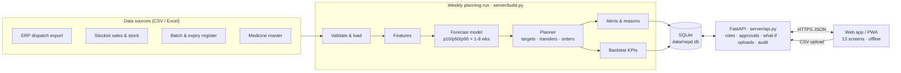

# Tech stack, architecture and tools — NE Pharma Supply Planner (NESFIC-I-09)

Design principle: **as simple as possible, self-hostable in India, no special hardware, no paid platform lock-in.** Everything is open source. It runs on a laptop, one small cloud VM, or GRD's own server.

Diagram for slides: [`architecture.svg`](architecture.svg)

---

## 1. Tech stack

| Layer | Technology | Version used | Why this choice |
|---|---|---|---|
| Language | **Python** | 3.12 / 3.14 tested | Standard for data and ML; one language for pipeline, model and API |
| Data processing | **NumPy** | 2.5 | Fast vectorised simulation and feature building; no heavy data platform needed at this scale |
| Machine learning | **scikit-learn** `HistGradientBoostingRegressor` (quantile loss) | 1.9 | Gradient boosting with p10/p50/p90 forecasts; trains on ~810k rows in about 20 s on a laptop CPU, no GPU |
| Database | **SQLite** | 3.51 | Single file (~32 MB), zero administration, transactional, easy to back up. Swappable for PostgreSQL in production |
| API / web server | **FastAPI** + **Uvicorn** (ASGI) | 0.165 / 0.54 | Small, fast and typed, with auto-generated API docs at `/api/docs` |
| File upload | python-multipart | 0.0.34 | CSV/Excel-export uploads |
| Front end | **HTML + CSS + vanilla JavaScript** | — | No framework and no build step, so it loads fast on weak connections and is easy to maintain |
| Charts and map | Hand-written **SVG** chart library (`web/charts.js`, ~180 lines) | — | No CDN or chart licence; works offline; light enough for low-end phones |
| Offline / mobile | **Service Worker** + Web App Manifest (PWA) + localStorage cache | — | Installable on phones; last data stays viewable without a connection |
| Packaging | **Docker** (`python:3.12-slim`), `run.sh` | — | One command to run anywhere |
| Testing | FastAPI TestClient + httpx (`tests/smoke_test.py`) | — | 19 end-to-end checks covering approvals, roles, receipts, what-if and uploads |

**Deliberately not used:** Databricks, Spark, Kubernetes, React/Node build chains, external LLM APIs, map tile services and paid BI tools. None is needed at pilot scale (60 SKUs × 40 locations, or several times that), and each would add cost, setup or a dependency on internet access.

---

## 2. High-level architecture

### 2.1 Components

```
 ┌─────────────────────────── DATA SOURCES ───────────────────────────┐
 │  ERP dispatch export · Stockist sales & closing stock · Batch &   │
 │  expiry register · Medicine master   (CSV / Excel → CSV)           │
 └───────────────┬────────────────────────────────────┬───────────────┘
                 │ scheduled drop (pilot)             │ manual upload (Data import screen)
                 ▼                                    ▼
 ┌──────────────────────── WEEKLY PLANNING RUN ───────────────────────┐   ┌──────── API SERVER ────────┐
 │  server/build.py   (python -m server.build, ~1 min)                │   │  server/api.py  (FastAPI)  │
 │   1 Load & validate data           (today: server/sim.py synthetic)│   │  • read: overview, plan,   │
 │   2 Features: lags, in-stock level, season, festival, route        │   │    forecast, inventory,    │
 │   3 Forecast  p10/p50/p90 × 1–8 weeks   (server/model.py)          │   │    expiry, orders, alerts  │
 │   4 Plan: target stock, transfers, expiry-capped orders, priority  │──▶│  • write: approve/modify/  │
 │   5 Alerts + plain-language reasons                                │   │    reject, order status,   │
 │   6 Backtest KPIs (manual vs planner)                              │   │    adjustments, settings   │
 └───────────────────────────────┬────────────────────────────────────┘   │  • what-if (Monte Carlo)   │
                                 ▼                                         │  • CSV upload checks,      │
                    ┌──────── data/nepd.db (SQLite) ────────┐              │    CSV export              │
                    │ masters · weekly history · forecasts │◀────────────▶│  • role scoping, audit log │
                    │ batches · orders · recommendations   │              └─────────────┬──────────────┘
                    │ alerts · impact · users · audit      │                            │ HTTPS / JSON
                    └───────────────────────────────────────┘                            ▼
                                                              ┌──────────── WEB APP (browser / phone) ───────────┐
                                                              │ web/ index.html · app.js · charts.js · sw.js     │
                                                              │ 13 screens · SVG charts · offline cache · PWA    │
                                                              │ Users: Head of Supply Chain · Planners ·         │
                                                              │ Regional managers · Field (read-only)            │
                                                              └──────────────────────────────────────────────────┘
```



### 2.2 Two flows

**Weekly batch flow (planning).** Run once a week, or nightly if needed, by cron, Windows Task Scheduler or a container job:
1. Load and validate data.
2. Train or refresh the forecaster.
3. Forecast every medicine × location for the next 1–8 weeks.
4. Compute this week's suggestions, transfers, expiry actions and alerts.
5. Write the results to SQLite.

**Interactive flow (decisions).** The web app calls the JSON API. Planners review suggestions and approve, change, postpone or reject them, each with a reason. Orders above the approval limit go to the Head of Supply Chain. Approved items become depot dispatch or transfer orders, and receiving an order adds a batch to stock. Every write lands in the audit table.

### 2.3 Data model (SQLite, 18 tables)

| Group | Tables |
|---|---|
| Masters | `medicines`, `locations`, `weeks`, `users`, `settings` |
| History | `weekly` (sales, closing stock, stock-out flag, expired units per medicine × location × week) |
| Stock | `batches` (batch, quantity, mfg and expiry dates, status), `orders` (dispatches and transfers with status) |
| Model output | `forecast` (next 8 weeks, p10/p50/p90), `forecast_backtest`, `forecast_adjustments` |
| Planning | `recommendations` (quantity, transfer, reason, priority, decision trail), `alerts` |
| Results | `impact`, `impact_weekly`, `meta` |
| Governance | `audit`, `uploads` |

### 2.4 Security and compliance in the design

- **Data residency:** a single server in an Indian cloud region or on GRD premises. There are no third-party APIs, AI services or CDNs, so the browser loads nothing from outside.
- **Access control:**
  - Each user sees only their own states.
  - Viewers cannot see costs or values.
  - Planners can approve up to the limit; the Head approves above it.
  - Only the Head can change settings.
- **Audit trail:** who, when, what and why for every approval, change, upload, receipt and setting.
- **Privacy:** no patient data is used (only medicine, location, sales and stock), which keeps DPDP Act 2023 exposure minimal.
- **Pharma rules:** FEFO issue, no dispatch with under 91 days of shelf life, and batch-level traceability.
- **Prototype note:** sign-in is a demo user switcher. Production adds real authentication (see 2.5).

### 2.5 From prototype to pilot to scale

| Concern | Prototype (now) | Pilot (12–16 weeks) | Scale (all NE states) |
|---|---|---|---|
| Hosting | Laptop / any VM | 1 VM, 2 vCPU / 4 GB, Indian region, or GRD on-premises | Same VM, larger; or 2 VMs (API + batch) |
| Data in | Synthetic (`sim.py`) | Scheduled CSV/SFTP drop from ERP and stockists, plus manual upload | ERP API connector |
| Database | SQLite | SQLite with nightly backup | PostgreSQL (schema unchanged, driver swap) |
| Sign-in | Demo user switcher | Username + OTP, or GRD SSO | SSO / OAuth2 |
| HTTPS | Local | Caddy or Nginx reverse proxy with Let's Encrypt | Same |
| Scheduling | Manual `python -m server.build` | cron / systemd timer, weekly | Nightly |
| Alerts out | In-app | Email digest of urgent items | Email + WhatsApp / SMS |
| Monitoring | Logs | `/api/health` uptime check, build log | Prometheus/Grafana or the cloud's monitoring |
| Rough running cost | ₹0 | ~₹2,000–4,000 / month (estimate) | ~₹5,000–10,000 / month (estimate) |

**Capacity check:** the planning run takes about 1 minute for 2,400 series on a laptop. Feature building and gradient boosting scale roughly linearly, so 10× more SKUs or locations is still a run of minutes on one VM.

---

## 3. Tools

### 3.1 Used to build and verify this prototype

| Purpose | Tool |
|---|---|
| Environment and packages | **uv** / pip, Python `venv` |
| Editor and version control | VS Code (any editor), **Git** |
| Data checks | **sqlite3** command-line client |
| API testing | FastAPI TestClient + httpx (`tests/smoke_test.py`), curl, Swagger UI at `/api/docs` |
| UI testing | Chrome + **Chrome DevTools**: screenshots at desktop 1440 px and mobile 390 px, console error checks across all 13 screens |
| Containers | **Docker** |

### 3.2 For the pilot (proposed, all open source or standard)

| Purpose | Tool |
|---|---|
| Hosting | Any Indian-region VM (MeitY-empanelled cloud preferred for government-linked work) or GRD on-premises server |
| Reverse proxy / HTTPS | Caddy or Nginx + Let's Encrypt |
| Process management | systemd or Docker Compose |
| Scheduling | cron / systemd timer, or Windows Task Scheduler on-premises |
| Backups | Nightly SQLite `.backup` copy to object storage or a second disk |
| Data intake | SFTP folder or shared drive for ERP/stockist CSV exports; Excel → CSV templates from the Data import screen |
| Monitoring | Uptime check on `/api/health`; build log review |
| Collaboration | Weekly review using the Impact screen and CSV exports |

---

## 4. Repository map

```
nesfic-i09/
├── server/
│   ├── sim.py        synthetic NE network, demand, disruptions; manual and planner policies (NumPy)
│   ├── model.py      global quantile gradient-boosting forecaster (scikit-learn)
│   ├── build.py      weekly planning run → data/nepd.db
│   ├── api.py        FastAPI app: 28 endpoints + static web hosting
│   ├── schema.sql    SQLite schema (18 tables)
│   └── seeds.json    medicines, districts, festivals
├── web/              index.html · styles.css · charts.js · app.js · sw.js · manifest.json
├── samples/          CSV templates for upload
├── tests/            smoke_test.py (19 checks)
├── run.sh · Dockerfile · requirements.txt · requirements-dev.txt
└── README.md · PLAN.md · ARCHITECTURE.md · architecture.svg
```
